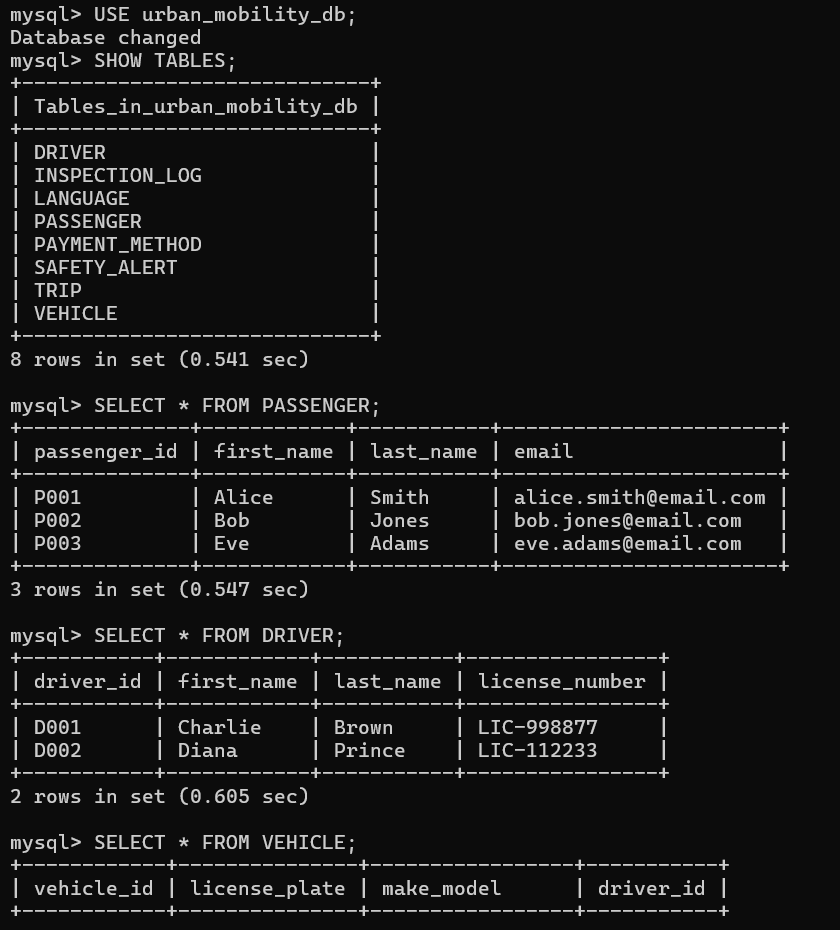

# urban-mobility-app
Connection to MySQL using Python

## Setup

Ensure you activate your virtual environment

```bash
cp .env.example .env
uv venv # or however you create your venv
# activate venv, OS specific
uv pip install -r requirements.txt # uv sync
python main.py

